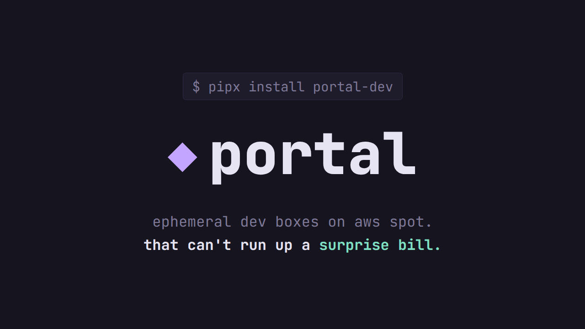

# portal

[](https://github.com/cjagadheesh/portal/actions/workflows/ci.yml)

> Ephemeral cloud dev boxes on AWS Spot that can't run up a surprise bill.

A cloud dev box costs pennies an hour and hundreds of rupees a month when you forget it, and
a shutdown script that lives on your laptop fails exactly when your laptop does. `portal`
gives you a spot box you can shell into in about a minute, and puts its end-of-life in AWS
itself: every box carries an expiry tag, and a Lambda that trusts nothing else terminates
anything past it.

[](docs/media/portal-launch.mp4)

A 47-second [launch video](docs/media/portal-launch.mp4) (MP4, 3 MB, narrated) walks through the
problem, `portal up`, `ssh`, `sync`, the four safety layers and `portal down`. It is an animated
explainer: like the session below, its terminal output is illustrative, not a recording.

```text
$ portal init --region ap-south-1 --budget-usd 20     # once per AWS account
$ portal up --ttl 4h                                   # instance types come from .portal.yaml
  spot c7g.xlarge: launched
image: baked portal image (fast boot)
home volume vol-0def (reused, 20 GB) attached at /home/dev
expires 2026-10-21T14:12:00Z; connect with `portal ssh --name dev`
$ portal ssh                                           # a shell over SSM; no SSH, no open ports
$ portal sync --watch                                  # push your code; edits land in about a second
$ portal cost
$ portal down                                          # box gone, home volume kept for next time
```

That is a typical session, not a recording. A terminal GIF needs a real AWS account:
`docs/demo.tape` is the [vhs](https://github.com/charmbracelet/vhs) script to record one.

## Status: built, tested offline, not yet run on real AWS

The whole planned feature set is implemented. **No part of it has run
against a real AWS account yet.** Everything is tested against `moto` and local fakes: over 300
tests, no credentials needed, outbound network blocked while they run, and rules such as "no
inbound security group rules", "no hardcoded region" and "every list call paginates" are
checked mechanically. What offline tests cannot prove (the Lambda really being invoked, the
IAM role working, process names on the box, how long boots take, what two minutes is worth in
a spot interruption) is written up as drills to run once on your first deployment:
[safety-net drill](docs/safety-net-drill.md) and
[spot interruption drill](docs/incidents/spot-interruption-drill.md). Treat the first week as
a test and keep the budget alarm small.

## Install

```bash
git clone <this repo> && cd portal
uv sync
uv run portal --help
```

From PyPI (after the first release is published): `pipx install portal-dev`.

You need Python 3.11+, [uv](https://docs.astral.sh/uv/), Terraform ≥ 1.5, the AWS CLI v2 with the
[Session Manager plugin](https://docs.aws.amazon.com/systems-manager/latest/userguide/session-manager-working-with-install-plugin.html),
rsync 3.1+ and AWS credentials. Details and every command: [docs/usage.md](docs/usage.md).

```yaml
# .portal.yaml, committed with your project
instance_types: [c7g.xlarge, m7g.xlarge]   # tried in this order; one CPU architecture
default_ttl: 4h
```

## The safety design

The shutdown guarantee has four layers, and each works without the others:

| Layer | Runs where | Catches | Fails when |
|---|---|---|---|
| 1. TTL + `portal down` | Your laptop | Normal use | The laptop dies |
| 2. Idle agent | On the box | You walked away | The box wedges or the agent crashes |
| 3. Reaper Lambda, every 5 min | AWS | Everything above failing | An AWS region outage |
| 4. AWS Budget alarm | AWS billing | Catastrophic misconfiguration | You ignore the email |

**Layer 3 is the one that matters.** It reads only EC2 tags: `portal:managed=true` plus
`portal:expires-at`. It has no link to the CLI, the agent or any local state. Its IAM role can
only terminate instances that already carry `portal:managed=true`, so even a bug in its code
cannot touch an untagged instance. A box with a missing or unreadable expiry gets a one-hour
grace period and is then terminated ([ADR-007](docs/adr/0007-reaper-semantics.md)).

**Tags are applied when the instance is created**, not afterwards. A crash between "create"
and "tag" would leave an instance the reaper can't see. Expiry times are computed from AWS's
clock rather than your laptop's, so a wrong laptop clock can't shorten or lengthen a box's life.

**Your work survives the box.** `/home/dev` is a separate EBS volume. On a spot interruption
the box has about two minutes: it stops containers, syncs, unmounts cleanly and marks the
volume resumable ([ADR-008](docs/adr/0008-drain-order.md)). `portal up --resume` continues
with the same home and the original expiry.

The idle rule has a deliberate, documented weakness: a detached job that mostly waits can look
idle ([ADR-006](docs/adr/0006-idle-detection.md)). Read it before relying on it.

After you deploy, **`portal doctor`** checks all of this against your real account, read-only:
no inbound rules, the box role, that the reaper is armed and has actually run, the budget, the cost
tags, whether your instance types are offered in your zones, and your spot quota.

More: [architecture](docs/ARCHITECTURE.md), [all ADRs](docs/adr/).

## How it compares

Honest version, from reading each project's documentation, not from benchmarks. These tools
move fast, so check their current docs before deciding.

| | What it is | What you run | Spend control |
|---|---|---|---|
| **portal** | A CLI for one person's AWS spot dev box | Nothing but the CLI and a small Terraform stack | Four independent layers; the strongest runs in AWS and trusts only tags |
| **DevPod** | Client-only, open-source dev environments on many providers (AWS, GCP, Docker, Kubernetes) | Nothing server-side | Provider-dependent; has auto-stop on inactivity |
| **Coder** | A self-hosted platform that provisions workspaces from Terraform templates | A Coder server (plus database) for a team | Workspace autostop and TTL policies, enforced by the server |
| **Gitpod** | A hosted service for cloud development environments | Nothing; it runs it for you | Handled by the vendor's plans and timeouts |

Where the others are the better choice: if you want **devcontainer support, IDE integration,
other clouds, a web UI, or a team product**, use one of them. `portal` has none of that. It is
AWS-only, one user per account, and it has never been run in anger. Where `portal` is
different: the tag-scoped reaper is an enforcement point that doesn't depend on any
long-running server or on your machine staying on, and the whole thing is small enough to read
in an afternoon.

## Minimum IAM policy

[`docs/iam-policy.json`](docs/iam-policy.json) is what day-to-day use needs, and
[`docs/iam-policy-doctor.json`](docs/iam-policy-doctor.json) adds the optional read-only permissions
`portal doctor` uses (without them its checks are skipped, not failed).
[`docs/iam-policy-init.json`](docs/iam-policy-init.json) is what `portal init` needs once to
create the control plane (the second is derived from the Terraform resources and is the part most
likely to need a tweak on your first apply). A test fails if the code calls an AWS API that isn't
in the first one. Replace the `<ACCOUNT_ID>` and `<REGION>` placeholders with
yours. The reaper's own role is separate and far narrower: describe instances, terminate only
instances tagged `portal:managed=true`, write its own logs.

## What portal will never do

- **Open an inbound port.** The security group has no ingress rules. Access is through AWS
  Systems Manager Session Manager, and file sync goes through a port-forward to a daemon bound
  to `127.0.0.1`. There are no SSH keys. Even the Packer build uses SSM.
- **Terminate something it didn't create.** `down` only touches instances tagged
  `portal:managed=true` and owned by your OS user; the reaper only instances tagged
  `portal:managed=true`.
- **Start on-demand instances without asking.** If no spot type has capacity it shows the
  price and waits for a typed yes. There is no flag to skip that.
- **Delete your files without a typed confirmation.** `down --purge` makes you type the box
  name, and `--yes` doesn't skip it.
- **Hardcode a region, AMI id, instance type or price.** Config or lookup, every time.
- **Touch real AWS from its tests.** They run offline, and a test that needs credentials is
  treated as broken.

## Known limitations

Written down so you are not surprised by them:

- **AWS only, one region per control plane, one person per account.** Several people sharing an
  account are separated only by the `portal:owner` tag, which is not an access control.
- **Linux and macOS.** Windows works only under WSL.
- **A spot interruption is survived, not hidden.** Your files and the TTL survive; running
  processes do not, and you resume yourself with `portal up --resume`.
- **`portal cost` is a trend,** from Cost Explorer: up to a day behind, and each call costs
  about a cent. The status table's cost is an estimate from the current spot price.
- **Two laptops racing** to start the same box name can both succeed; the per-box lock protects one
  machine. The reaper bounds the damage.
- **Tags are the trust root.** See [SECURITY.md](SECURITY.md).
- **Not battle-tested.** See the status section at the top: run `portal doctor` and the drills.

## Development

```bash
uv run ruff check && uv run ruff format --check .
uv run mypy --strict portal agent infra/reaper/handler.py
uv run pytest                        # offline; needs no AWS account
terraform -chdir=infra/control-plane validate
```

See [CONTRIBUTING.md](CONTRIBUTING.md). The decisions behind the design are in
[docs/adr/](docs/adr/), and what went wrong along the way is in
[docs/what-broke.md](docs/what-broke.md).

## License

[MIT](LICENSE). The licence covers the code. The launch video's music, sound effects and
narration have their own terms; see [docs/media/CREDITS.md](docs/media/CREDITS.md).
